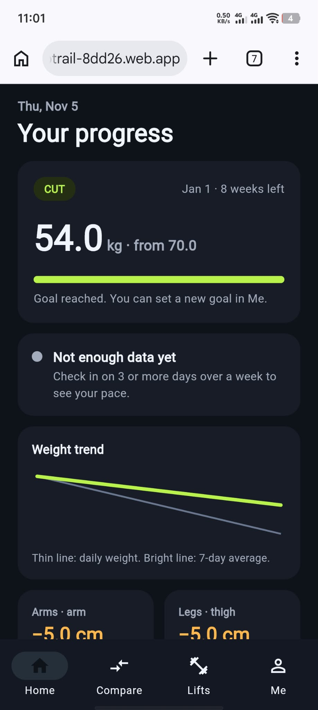
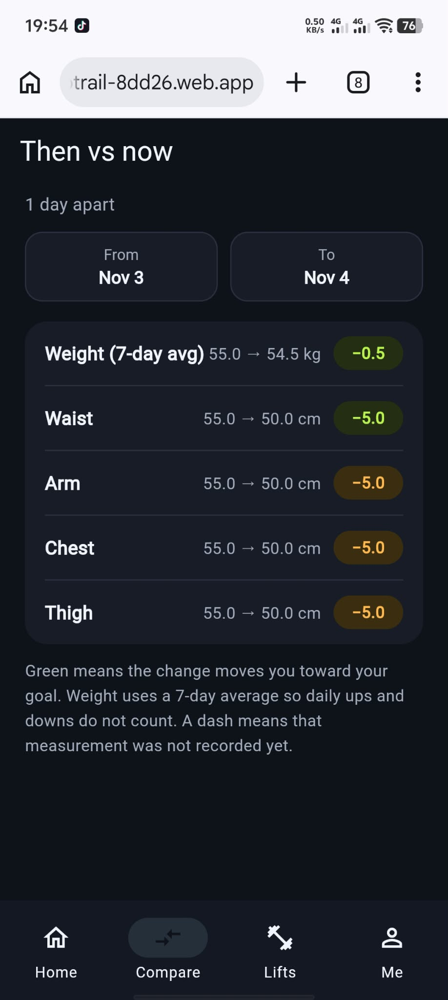
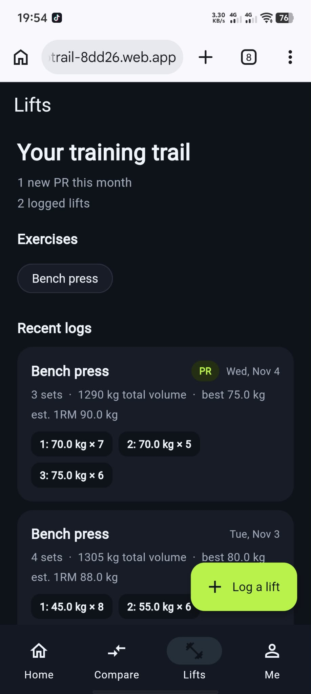
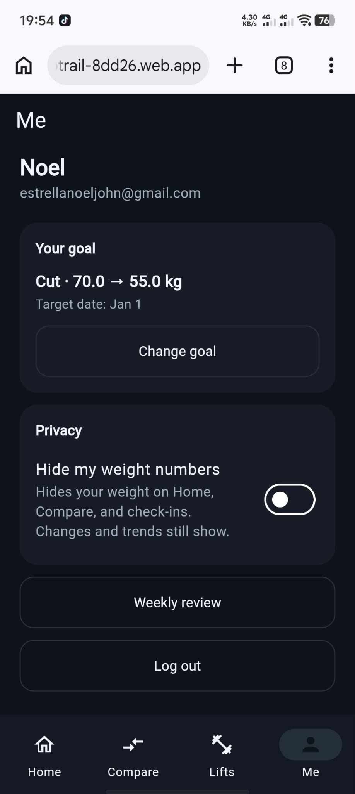

# RepTrail

A goal-first gym progress tracker. Pick a goal (bulk, cut, recomp, or performance), check in with your weight and measurements, and RepTrail tells you whether you are on track. It compares "then vs now", follows the body parts you care about, and logs your lifts with estimated one-rep max and PRs.

**Live demo:** https://reptrail-8dd26.web.app

Create a free account to try it. Each account only sees its own data.

## Screenshots

| Home | Then vs now | Lifts | Weekly review |
|---|---|---|---|
|  |  |  |  |

## Why I built it

Several of my friends started going to the gym. The scale jumps around from day to day, photos end up scattered in camera rolls, and nothing connects the numbers to a goal. RepTrail turns those numbers into one answer: am I on track?

## Features

- **Goals:** bulk, cut, recomp, or performance, with a target weight and date. A suggested weekly pace is shown while you set it up, and the goal can be changed later.
- **Check-ins:** weight daily and arm, waist, chest, and thigh measurements weekly. One check-in per day, and you can fix a past day.
- **Weight trend:** a 7-day average line over the daily weights, so one heavy day does not look like failure.
- **Pace check:** compares your weekly rate of change with a suggested range for your goal and says whether you are on track, too fast, too slow, or moving the other way.
- **Then vs now:** pick any two check-ins and see the change in weight and each measurement. Green means the change moves you toward your goal.
- **Focus areas:** follow Arms, Legs, or Chest with a size chart and the change since your first measurement.
- **Lifts:** log sets and reps. See total volume, best set, estimated 1RM, PR badges, and PRs this month.
- **Weekly review:** a Monday to Sunday summary with a verdict, check-in count, trend change, focus area changes, and tips for next week.
- **Privacy:** a "hide my weight numbers" switch that hides absolute weights while trends and changes still show.
- **Account:** email and password sign-in, with password reset.

## How the numbers work

The calculations are plain Dart functions with unit tests.

| Feature | Method |
|---|---|
| Weight trend | Trailing average over the last 7 days |
| Weekly rate | Slope of a straight line fitted to the trend over the last 14 days |
| Suggested pace | Cut: 0.5 to 0.9 percent of body weight per week. Bulk: 0.25 to 0.5 percent per week |
| Then vs now | Subtraction. Changes smaller than the measuring error (0.3 kg, 0.5 cm) count as no change |
| Good or bad change | Depends on the goal. A smaller waist is good on a cut, a larger arm is good on any goal |
| Estimated 1RM | Epley formula: weight × (1 + reps ÷ 30) |
| PR | A log whose best estimated 1RM beats every earlier log of that exercise |

All numbers are typed in by the user. Nothing is scanned or detected from photos.

## Tech stack

| Area | Choice |
|---|---|
| App | Flutter (Dart) for web, with an Android project configured |
| State management | Riverpod |
| Navigation | go_router with a bottom navigation shell |
| Backend | Firebase Authentication and Cloud Firestore |
| Hosting | Firebase Hosting |
| Testing | flutter_test |

The app runs on the free Firebase Spark plan.

## Project structure

The code is organized by feature. Data flows one way: **Firestore repository → Riverpod provider → screen**.

```
lib/
  core/          theme, date helpers, number formatting
  shell/         bottom navigation
  features/
    auth/        welcome (log in), create account
    goal/        goal setup and change goal, pace guide
    progress/    check-ins, trend and pace math, charts
    home/        Home dashboard
    checkin/     check-in screen
    compare/     then vs now
    focus_area/  Arms, Legs, Chest pages
    lifts/       lift logs, estimated 1RM, PRs
    review/      weekly review
    profile/     Me screen, profile data
  router.dart    routes and login redirects
  main.dart      app startup
test/            unit tests for the calculations
```

## Data model

All data lives under the signed-in user.

| Path | Fields |
|---|---|
| `users/{uid}` | name, email, hideWeight, goal (type, startWeightKg, targetWeightKg, startDate, targetDate, focusAreas) |
| `users/{uid}/checkins/{yyyy-MM-dd}` | date, weightKg, arm, waist, chest, thigh |
| `users/{uid}/lifts/{id}` | exercise, sets (weight and reps), date |

The check-in document ID is the date, so there is one check-in per day and saving again replaces it.

## Security

Firestore Security Rules let each user read and write only their own documents:

```
rules_version = '2';
service cloud.firestore {
  match /databases/{database}/documents {
    match /users/{userId} {
      allow read, write: if request.auth != null && request.auth.uid == userId;
    }
    match /users/{userId}/{document=**} {
      allow read, write: if request.auth != null && request.auth.uid == userId;
    }
  }
}
```

## Getting started

### Prerequisites

- [Flutter SDK](https://docs.flutter.dev/get-started/install)
- [Node.js](https://nodejs.org) and the Firebase CLI (`npm install -g firebase-tools`)
- A Firebase project (the free Spark plan is enough)

### Setup

1. Clone the repository and install packages:

   ```bash
   git clone https://github.com/estrellanoeljohn-lab/rep_trail.git
   cd rep_trail
   flutter pub get
   ```

2. In the Firebase console, enable **Email/Password** sign-in under Authentication, create a **Firestore** database, and publish the security rules above.

3. Connect the app to your own Firebase project. This regenerates `lib/firebase_options.dart`:

   ```bash
   dart pub global activate flutterfire_cli
   flutterfire configure
   ```

4. Run the app:

   ```bash
   flutter run -d chrome
   ```

## Tests

```bash
flutter test
```

The tests cover the pace guide, trend and weekly rate, goal progress, the then vs now rules, the weekly review, and estimated 1RM and PR detection.

## Deployment

```bash
flutter build web --release
firebase deploy --only hosting
```

## Known limitations

- There are no check-in reminders yet.
- Progress photos are not supported. Firebase Cloud Storage needs a paid plan, so the app tracks numbers only.
- Friends and sharing are not built yet.
- Focus areas support Arms, Legs, and Chest. Back, Core, and Shoulders have no measurement yet.
- Your data can be removed by asking me. A delete-my-data button is not built yet.
- The Android project is configured, but the app has not been built or published for Android.

## Roadmap

- Delete my data
- Check-in reminders
- Friends, sharing only progress percent and streaks
- Forearm and grip tracking for arm wrestling
- Android release

## Not medical advice

RepTrail is a personal tracker. The suggested pace is a general guide, not medical advice.

## Author

Built by [@estrellanoeljohn-lab](https://github.com/estrellanoeljohn-lab) as a personal project for friends who just started going to the gym. The screens were designed first as an 11-screen prototype, then built with Flutter and Firebase.